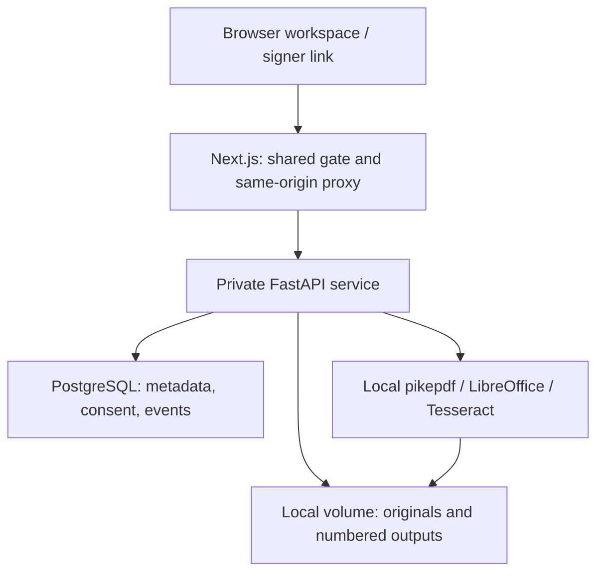

# Papertrail PDF

A personal PDF desk using **Next.js 15, TypeScript, Python 3.12, FastAPI, pikepdf, LibreOffice headless, Tesseract, and PostgreSQL**. Every original stays read-only. Each operation publishes a separate numbered PDF, with input and output SHA-256 hashes in an append-only event log.

> **Low-stakes personal use only.** Typed signature links provide no identity verification or qualified/regulated signature service. Inspect every output before relying on it. This is a personal PDF toolkit, with no accounts, billing, analytics, telemetry, or hosted control plane.

## Start locally

Install Docker with Compose v2. From this repository, run:

```sh
docker compose up --build -d --wait
```

Open **http://localhost:3000**. The API and its docs are at http://localhost:8000/docs. Both exposed ports bind only to `127.0.0.1`; PostgreSQL has no published port. First build downloads dependencies; subsequent transformations run inside your own containers. No conversion vendor receives your files.

For a non-disposable local installation, copy `.env.example` to `.env` before the first run and change `POSTGRES_PASSWORD` **and** the matching password in `DATABASE_URL`. A shared `WORKSPACE_PASSWORD` is optional locally; the username in the browser password dialog can be `workspace`. This gate creates no user account. Never commit `.env`. Changing PostgreSQL environment variables after a database volume exists does not rotate its existing password.

Stop with `docker compose stop`. Restart with `docker compose start`. **`docker compose down -v` deletes the local database and documents**; do not use it on your real library unless you intend to erase it.

## Everyday workflow

1. Add PDFs or Office files (DOCX, XLSX, PPTX, ODT, ODS, ODP), up to 50 MiB each. An Office upload keeps the original and creates PDF version 1 using LibreOffice.
2. Select a document and a source version. Inspect any page with Previous/Next or the page-number input. Office originals can be downloaded; select the converted PDF version to edit them.
3. Choose merge, split (extract a page range), reorder, rotate, compress, watermark, redact, annotate, or OCR. Each successful action creates another file; existing versions are never replaced.
4. For redaction or annotation, drag a rectangle on the preview or enter coordinates. Coordinates are PDF points from the visible page's top-left, including rotated pages. Download and inspect the resulting version.
5. Export the active library as ZIP, configure document expiry, or delete the document and its versions. Deletion retains audit metadata, including names and consent records; file deletion is not secure disk erasure and does not erase independent backups.

Merge appends selected documents' **latest PDF versions** in the visible order. Reorder must list each page exactly once. Compression is lossless repackaging; size reduction varies and output can be larger. PDFs support up to 1,000 pages per file; OCR supports up to 200 pages per operation. Split larger files before OCR. OCR rebuilds pages and can alter quality, accessibility, forms, links, and text. Review recognized text.

Form-aware assembly uses pikepdf's `add_pages_from`, preserving ordinary AcroForm fields and renaming collisions. This is not a guarantee for every PDF feature. Fonts, forms, existing digital signatures, attachments, bookmarks, and encryption can behave differently after editing or conversion. Encryption, including passwordless owner-restricted PDFs, is rejected; unlock your copy before importing. Existing digital signatures may become invalid after any modification. The warning is shown in the workspace.

Redaction removes content in the selected region; it does **not** certify the absence of sensitive information elsewhere, in metadata, attachments, annotations, or hidden layers. Keep the original and inspect the output with an independent viewer.

## Typed signatures

Place a rectangular field on the preview, enter the signer name, and create an invitation. The link expires after seven days by default and can be revoked from the owner workspace. **No email is sent**: the delivery event explicitly records `link_created_not_sent`. Copy and share it through a channel you choose. Anyone possessing the link can view and sign that document version, so treat it as a private capability.

The signer can preview every page and download the invited PDF before consent. They must type the invited name and check consent. The service writes a new PDF with the typed name, stores consent time and the final SHA-256 hash, and permits downloading that sealed version. Replay is rejected. This is a hash receipt, not a cryptographic PDF signature or qualified signature certificate.

Invite the next signer to the latest sealed version. If a document is edited or another signer seals it first, an older pending link cannot seal; revoke it and create a fresh link to the latest version. This prevents one signer from silently discarding another's signature. The built-in typed-signature font supports a limited character set; an unsupported name or an overflowing field produces a recoverable error.

On a purely local installation, `localhost` links work on the owner's computer only. In-person signing on that computer works without remote hosting. Sharing a link to another device requires deliberate private networking and a reachable `APP_PUBLIC_URL`. Do not expose this unauthenticated API to the internet.

## Architecture, permissions, and storage



The web proxy independently enforces access in its request handler, so middleware is not the sole security boundary. It blocks cross-site mutations and exposes only the matching invitation's read/preview/download/seal routes without the workspace password. The API itself has no authentication: only use it on a trusted local machine or private container network. Any local user who can reach port 8000 can use it. Signer links are bearer capabilities, not authenticated identities.

Compose stores document bytes in the `pdfdata` volume, under `/data/<document-id>/original.<ext>` and `/data/<document-id>/v<number>.pdf`. PostgreSQL lives in `pgdata`. Docker prefixes volume names with the Compose project name; inspect them with `docker volume ls`. The `.env` file configures secrets and public URL; it is not a data backup.

Operations lock document rows in a stable order, stage output on the same filesystem, and publish with a no-replace hard link. Before serving or transforming files, the API verifies their recorded hashes. Versions and originals are read-only to discourage accidental changes. An administrator can still change filesystem permissions. PostgreSQL triggers reject ordinary event UPDATE/DELETE/TRUNCATE; a database administrator can bypass or remove those protections. Preserve independent backups for stronger audit assurance.

Expiry denies access at the deadline, even between sweeps. A worker removes expired bytes about once per minute. Failed deletion leaves a tombstone that denies further access, returns `cleanup_pending`, and retries on later sweeps. Health reports database/store readiness plus local OCR/Office availability. Missing dependencies, invalid inputs, unavailable APIs, and stale signing links produce actionable errors.

Filesystem publication and a database commit cannot be one atomic transaction. A crash or uncertain commit may leave an orphan output; the service refuses to overwrite it. Back up both stores, compare the version row and file hash, then quarantine the unreferenced file outside the document folder before retrying. Do not delete a file referenced by a version row. Never "repair" a hash mismatch by changing its recorded hash without establishing the source of the change.

## Export, backup, and restore

**Export everything** downloads active originals, all active versions, `manifest.json` (including names, timestamps and every version hash), and `events.json` (including events for deleted documents). Expired documents are excluded. Invitation bearer tokens are excluded from portable events. This ZIP is portable, but importing it back into the application is not implemented. Pending invitations and full relational state require the complete backup below.

For a consistent complete backup, run:

```sh
sh scripts/backup.sh
```

The script stops API/web writers, dumps PostgreSQL, archives the file volume, and restarts the services. Save its output directory outside the Docker volumes and back up `.env` securely. Verify backups periodically.

Restore to a **fresh installation / empty volumes**, using a compatible PostgreSQL version. Keep existing data until the restored copy is verified:

```sh
docker compose up -d db
# Wait for db to be healthy: docker compose ps
docker compose exec -T db sh -c 'psql -v ON_ERROR_STOP=1 -U "$POSTGRES_USER" -d "$POSTGRES_DB"' < /path/to/backup/database.sql
docker compose run --rm --no-deps -v /absolute/path/to/backup:/backup:ro api python -c 'import tarfile; a=tarfile.open("/backup/files.tar.gz"); a.extractall("/data",filter="data")'
docker compose up -d --wait
```

Use only your trusted backup archive. This restores the default `/data` paths; if moving from a custom store path, update paths carefully before opening the application. Download an original and a version, compare SHA-256 values with their receipts, and export the restored library to verify recovery. The event trigger intentionally rejects truncation and deletion, so use a fresh database for restoration.

## Railway deployment

The owner has authorized Railway hosting. See [the deployment receipt and configuration](docs/railway-deployment.md) for current status, service wiring and validation requirements.

Local Compose remains available and needs no Railway service. Deploying here means files live on a remote server in your Railway project. Do not call that local storage. This repository does not create a hosted control plane.

For an explicitly chosen remote installation, use three services: PostgreSQL, API with root `api` and a persistent volume mounted at `/data`, and web with root `web`. Set API `DATABASE_URL`, `STORE_DIR=/data`, `PORT=8000`, and `APP_PUBLIC_URL` to the web URL. Keep API and database private. Set web `API_INTERNAL_URL=http://<api-service>.railway.internal:8000`, `WORKSPACE_PASSWORD`, and `REQUIRE_WORKSPACE_PASSWORD=1`. Only the web service should have a public domain. The web service refuses remote operation without a password. Use HTTPS, private networking, one API replica with the file volume, and independent backups.

## Tests and validation

CI builds the actual Compose stack, starts PostgreSQL, runs real PDF and database regression tests against a separate test database, exercises Office conversion and signing through the web proxy, and uses Playwright for upload → page navigation → rotate → download → signer review/consent → sealed download and a mobile layout check. It also checks recoverable API failures and unauthorized owner-API access from a signer context.

For an isolated test installation (default test credentials), run:

```sh
docker compose up --build -d --wait
docker compose exec -T db createdb -U pdf pdf_test
docker compose run --rm -e DATABASE_URL=postgresql://pdf:change-me-for-local-use@db:5432/pdf_test -e STORE_DIR=/tmp/test-store api python -m pytest -q tests
docker compose exec -T -e TEST_API_URL=http://web:3000/api api python tests/e2e.py
```

If a workspace password is enabled, pass `-e TEST_WORKSPACE_PASSWORD` to the API happy-path test from your environment. Tests create documents: never point them at your real library. See `.github/workflows/ci.yml` for the complete browser test sequence and uploaded screenshots/traces.

Without Docker, the focused transformations can be checked after installing `api/requirements.txt` and Tesseract:

```sh
PYTHONPATH=api python3 -m pytest -q api/tests/test_pdf_ops.py
cd web
npm ci --no-audit --no-fund
NEXT_TELEMETRY_DISABLED=1 npm run build
```

PostgreSQL tests require `DATABASE_URL`; without it they are explicitly skipped, not reported as verified. See `docs/verification.md` for release evidence and remaining boundaries.
